# Medalluin

> **A bespoke, artful HUD, unit frame, and console suite for World of Warcraft.**

Medalluin transforms World of Warcraft's interface into a unified, ornamental console rendered in an elegant ink-and-gold art style. By wrapping Blizzard's secure templates into custom frames, Medalluin preserves full native combat security, macros, drag-and-drop, and keybindings while delivering a modern, cohesive UI experience.

---

> [!NOTE]
> ### 🤖 AI-Assisted Development Disclaimer
> **Medalluin is developed with the assistance of Artificial Intelligence.** Design specifications, art tooling, secure template integration, and code iterations have been co-authored and refined using advanced AI paired with human testing and direction. Code is thoroughly linted and harness-tested for taint safety and combat protection.

---

## 📸 Showcase

### Console & Overhead
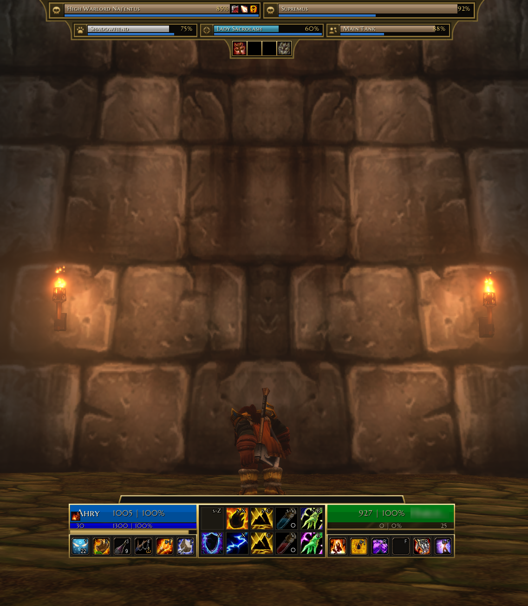

### Settings
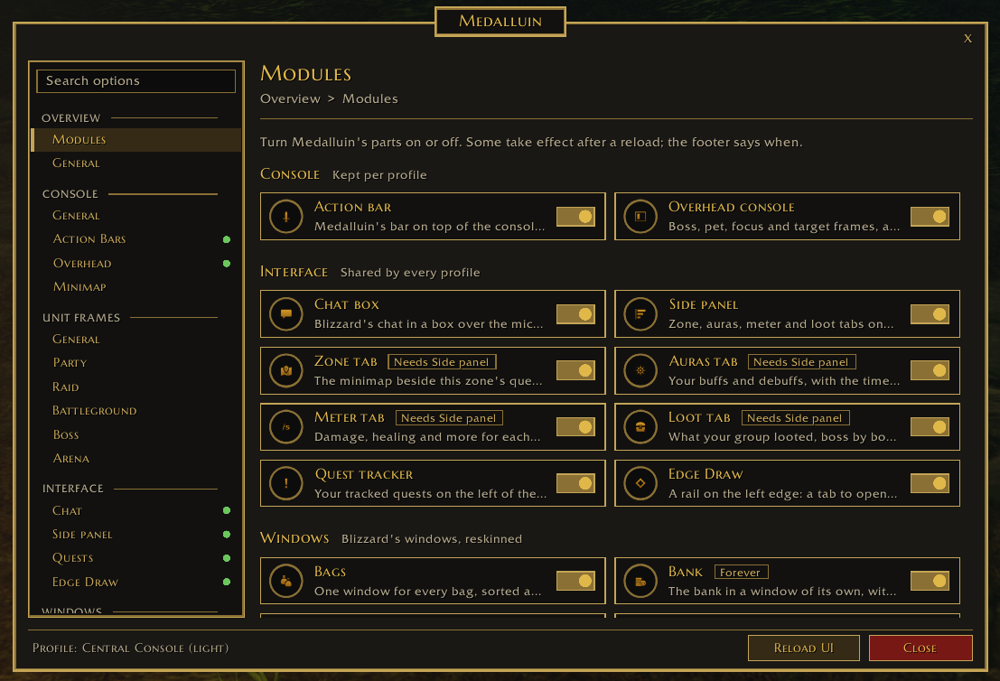

### Side Panel
| Zone | Loot |
|:---:|:---:|
| 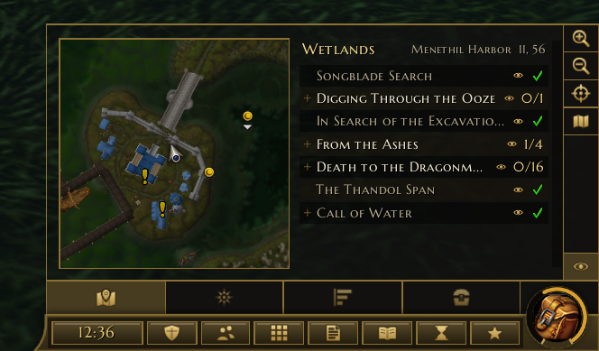 | 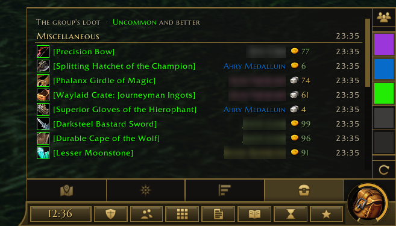 |

### Chat & Quests
| Quest Tracker & Chat | Quest Log |
|:---:|:---:|
| 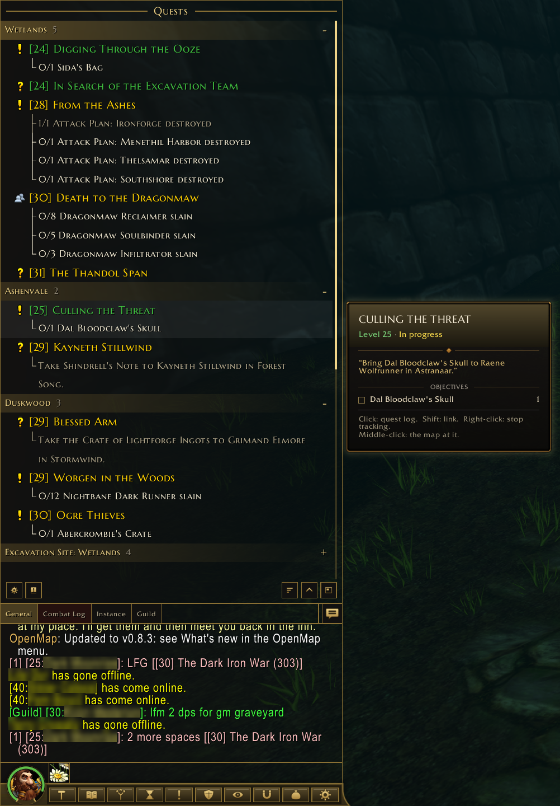 | 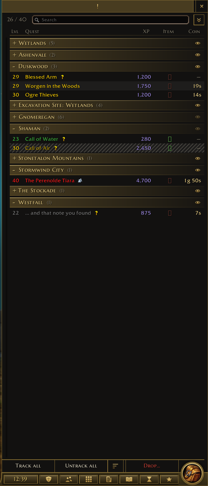 |

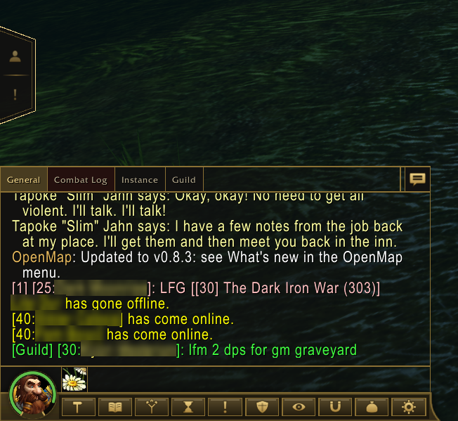

### Character, Spells & Bags
| Character | Bags |
|:---:|:---:|
| 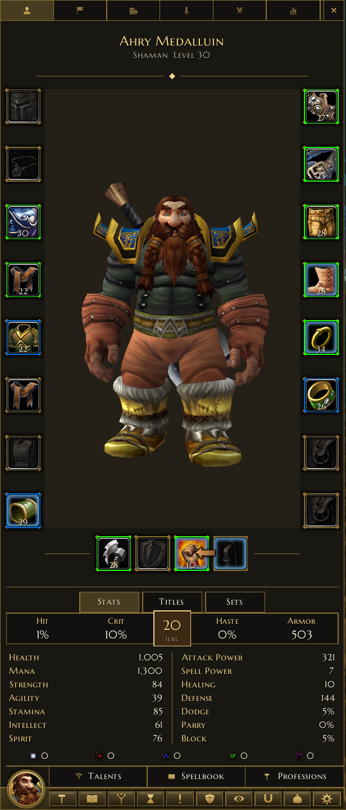 | 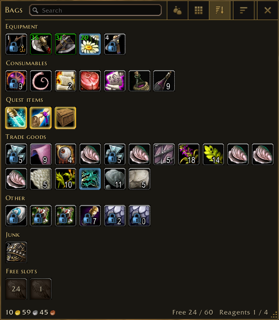 |

| Spellbook | Macros |
|:---:|:---:|
| 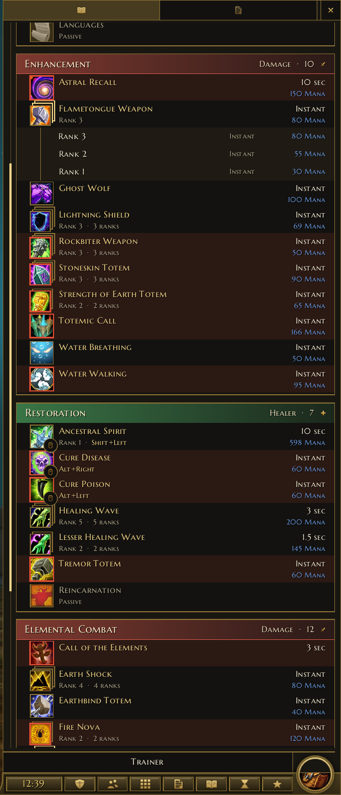 | 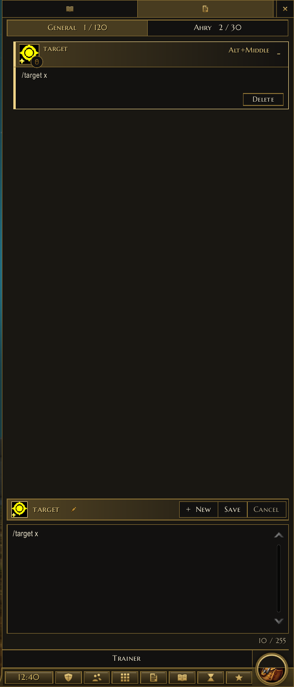 |

| Talents | Talent Plans |
|:---:|:---:|
| 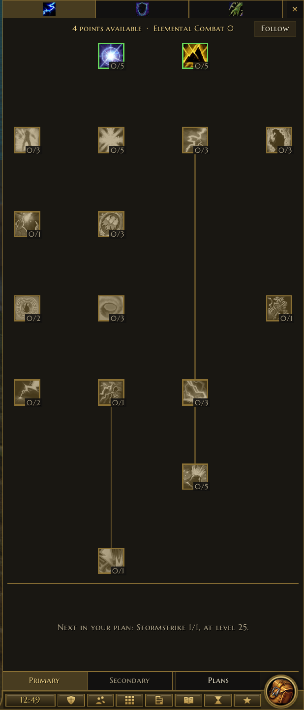 | 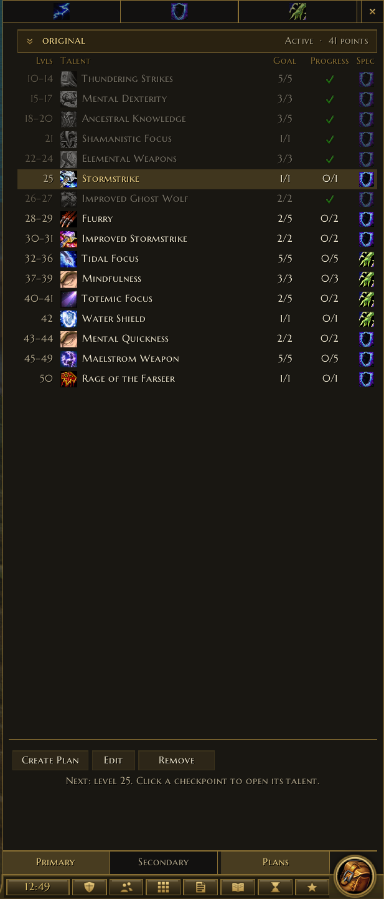 |

### Game Menu
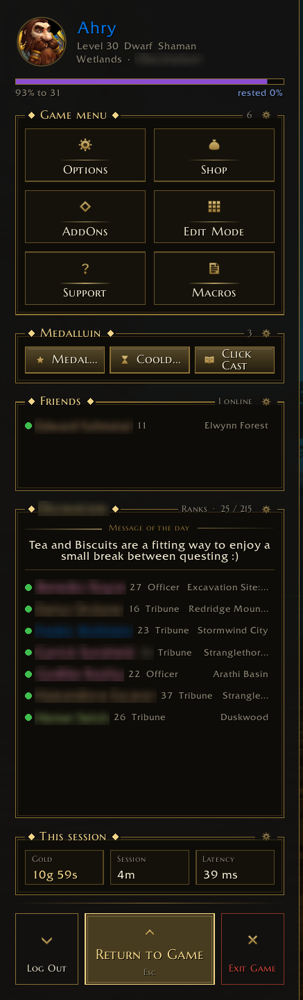

### Central Console
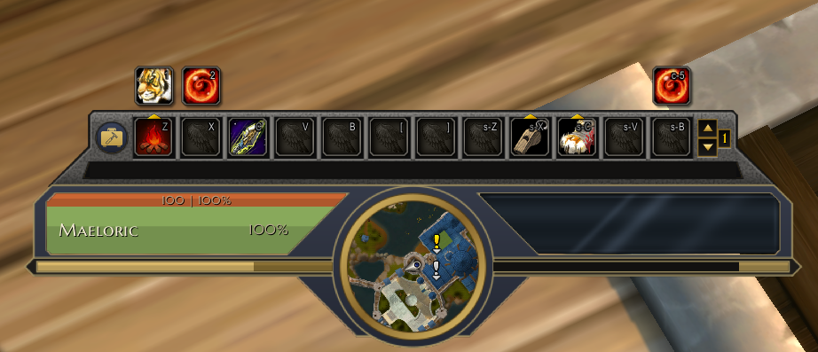

---

## ✨ Features

### 🎮 Central Console & Unit Frames
- **Player & Target Frames**: Sculpted into the primary bottom console with smoothly animated health/power bars, class colors, combat threat glows, and status badges.
- **Console Profiles**:
  - **Medallion (Default)**: Symmetrical ornamental console with central artwork, power/cast meters, and expandable side panels.
  - **Central Console (Light)**: Streamlined, compact variant featuring an integrated minimap bay, a 2x5 form/stance/skyriding center grid (`Action Bar 7`), and a dedicated 4-member party row directly under the console.
- **Overhead & Boss Frames**: Overhead boss cast bars, health bars, and target-of-target indicators designed to float cleanly above combat encounters.
- **Party & Raid Layouts**: Choose between the integrated **Console Row** or flexible, draggable **Widgets** for Party, Raid, Boss, and Arena units.
- **Distinctive Offline & Dead States**:
  - **Offline**: Distinct plug/unplug icon with diagonal hazard-striped texture bars.
  - **Dead**: Angel halo wings icon, formatted death duration timer, character name, and embossed skull-texture bars.

---

### ⚔️ Action Bars & Keybinds
- **Customizable Rows**: Run 1, 2, or 3 rows (Action Bar 1, MultiBar Bottom Left, and MultiBar Bottom Right).
- **Art Style Options**:
  - **With Art**: Preserves Blizzard's iconic button textures with tinting and custom frame styling.
  - **Bare Icons**: Modern WeakAuras-style clean flat icons with centered cooldown digits, formatted hotkey abbreviations (`s-1`, `c-E`, `M4`), and usable range tints.
- **Hide Empty Buttons**:
  - Automatically hides unused button slots and keybind text on extra bars (rows 2 and 3) while keeping Action Bar 1 and stance grids visible.
  - Seamless drag-and-drop: hovering an item, spell, or macro automatically reveals the empty slots so you can place abilities.
- **Built-in Power & Cast Bars**: Integrated segment-based class power display (Holy Power, Combo Points, Runes, Soul Shards, Arcane Charges, Dragonriding Vigor) and responsive cast bars.
- **Keybinding Overlay (`/mdlui kb`)**: Point and click on any action button and press a key to immediately bind or update hotkeys.

---

### ⚙️ Profiles & Complete Customizability
- **Per-Profile Independence**: Settings are stored per profile, allowing distinct layouts and settings across characters or specs.
- **Action Bar Skills & Keybinds by Profile**: Medalluin remembers which spells, items, macros, and bindings belong to each profile and restores them seamlessly on profile or spec switches.
- **In-Game Unit Frame Editor (`/mdlui edit`)**:
  - Interactive visual editor with a live side-by-side canvas.
  - Customize piece dimensions, fonts, text formats, offsets, and visibility for every unit frame.
  - Fully secret-guarded to prevent combat lockups and taint.

---

### 🎒 All-In-One Bags (Inspired by Baganator)
- **Single Window Experience**: Combines your backpack, equipped bags, and reagent bag into a single unified window.
- **Equipped Bag Drawer**: Open the bag drawer above the window to inspect, swap, or equip containers without cluttering the screen.
- **Automatic Category Grouping**: Organize items into intuitive categories: *New*, *Equipment*, *Consumables*, *Quest items*, *Trade goods*, *Junk*, and *Other*.
- **Blizzard Search & Sorting**: Full native support for text search, item quality dimming, and one-click bag sorting.
- **Responsive Resizing**: Drag the bottom-right corner dots to change columns across, with automatic window height scaling.
- **Item Locking**: Alt+click an item in your bags or bank to lock it. A padlock appears in its corner, its tooltip says "Locked", and it can no longer be destroyed or sold: it is left out of the vendor's Sell tab and Sell junk, and its right click does nothing at a vendor.

---

### 🌟 Miscellaneous Highlights
- **Dynamic LFG Queue Eye**: The queue status eye automatically replaces the character medallion on the left strip whenever you are in queue for a dungeon, raid, or battleground.
- **Dynamic Vehicle Exit Seat**: When operating a vehicle or on an early-landing taxi, a custom crimson-and-gold ejection seat replaces the backpack medallion on the right strip.
- **Minimap Addon Drawer**: Neatly collects minimap icons (DBM, Details, RaiderIO, Bagnon, etc.) into a collapsible drawer next to the action bar to keep your minimap clean.
- **Side Panel Integration**: Integrated side strip supporting embedded damage meters (Details/Recount), timeless logs, and aura trackers (with automatic combat hand-off to WoW's native Cooldown Manager Tracked Buff Bars).
- **Zone Tab**: The side panel's Zone tab moves the minimap into the panel beside the current zone's quests, each with its progress; click a quest for its objectives, shift-click to track it.

---

## 🧩 Companion Addons

Companion addons live alongside Medalluin under the **Medalluin** category in the game's AddOn List and have their own documentation and licenses:

| Companion Addon | Description | Documentation & License |
|:---|:---|:---|
| **[`mdlui_Tooltips`](WoW/Interface/AddOns/mdlui_Tooltips/README.md)** | Full ornamented tooltip reskin for items, spells, units, auras, quests, mail, and world objects on both WoW Forever (`16001`) and Retail WoW (`120105`). Based on [PrettyTooltip](https://github.com/FallenShard/PrettyTooltip) by FallenShard. | [README](WoW/Interface/AddOns/mdlui_Tooltips/README.md) · [MIT License](WoW/Interface/AddOns/mdlui_Tooltips/LICENSE) |

---

## 🤝 Recommended Addons

Medalluin pairs well with these addons by other authors. They are not part of Medalluin: install each one separately from CurseForge.

| Addon | What it adds | Clients |
|:---|:---|:---|
| **[PlateSCT](https://www.curseforge.com/wow/addons/platesct)** | Scrolling damage and healing numbers above enemy nameplates or in movable screen areas, with three display styles and clutter filters. | Forever · Retail |
| **[Shadowflare](https://www.curseforge.com/wow/addons/shadowflare)** | On-screen alerts for spell procs across all classes: when your next spell is instant, faster, free, or usable. | Forever |
| **[MF Nameplates](https://www.curseforge.com/wow/addons/mf-nameplates)** | Customizable nameplates with a live visual designer for arranging their elements. | Forever · Retail |
| **[Node Sight](https://www.curseforge.com/wow/addons/node-sight)** | Each herb's and ore's own icon on the minimap, with an optional arrow to the nearest node and sparkles on the ones in front of you. | Forever |
| **[LootOptimizer Forever](https://www.curseforge.com/wow/addons/lootoptimizer-forever)** | Frees bag space when your bags are full by swapping your least valuable item for new loot, and compares gear upgrades for you and your alts. | Forever |
| **[Keep or Toss: Forever](https://www.curseforge.com/wow/addons/keep-or-toss-forever)** | A tooltip section saying whether an item is useful to your character and why, and marking items new to WoW Forever. | Forever |

---

## ⌨️ Slash Commands

| Command | Description |
|:---|:---|
| `/mdlui` or `/mui` or `/medalluin` | Opens the Medalluin settings window |
| `/mdlui bar` | Opens settings directly to the Action Bars tab |
| `/mdlui party` / `raid` / `boss` | Opens settings directly to unit frame pages |
| `/mdlui kb` | Enters quick keybinding mode (hover button and press key) |
| `/mdlui edit` | Launches the interactive unit frame layout editor |
| `/mdlui taint` | Runs internal diagnostics to inspect secure variable integrity |

---

## ⚠️ Known Limitations

- **Side Panel Auras in Combat**: Due to Blizzard's combat aura API restrictions (`RequiresUnitAuraAccess` and secret values in `C_UnitAuras` / `UNIT_AURA`), addon code is blocked from querying newly applied auras while in combat. To work around this natively, the **Auras** tab automatically switches in combat to display WoW's native Cooldown Manager **Tracked Buff Bars** (`BuffBarCooldownViewer`), and restores the standard Buffs/Debuffs list when combat ends.

---

## 🛠️ Work in Progress & Contributions

> [!IMPORTANT]
> **Medalluin is an active work-in-progress (WIP).** 
> Features, textures, and capabilities are continuously evolving.

- **Issues & Suggestions**: Feel free to submit an issue on GitHub for bug reports, compatibility edge cases, or feature suggestions.
- **Pull Requests**: Community contributions, optimizations, and bug fixes are welcome! Please ensure code adheres to standard Lua conventions and passes `luacheck` and the test harness before opening a PR. By opening one, you agree to the contribution terms in section 4 of the [LICENSE](LICENSE).

---

## 📜 License

Medalluin is **All Rights Reserved** © 2026 AhryMX. You may install it, play with it, read its code, and change your own copy for personal use. Screenshots, videos, and streams are welcome. You may not reupload, redistribute, fork, retexture, or rebrand it, in whole or in part, without written permission. The only official copies are on [GitHub](https://github.com/ahrymx/ahrymx.medalluin) and [CurseForge](https://www.curseforge.com/wow/addons/medalluin/). See [LICENSE](LICENSE) for the full terms.

The optional `mdlui_Tooltips` companion addon is based on [PrettyTooltip](https://github.com/FallenShard/PrettyTooltip) © 2026 FallenShard and is included under the [MIT License](WoW/Interface/AddOns/mdlui_Tooltips/LICENSE). The Marcellus SC font is © Brian J. Bonislawsky (Astigmatic) and is included under the [SIL Open Font License 1.1](WoW/Interface/AddOns/Medalluin/media/fonts/OFL.txt). World of Warcraft is a trademark of Blizzard Entertainment, Inc.; Medalluin is not affiliated with or endorsed by Blizzard.
