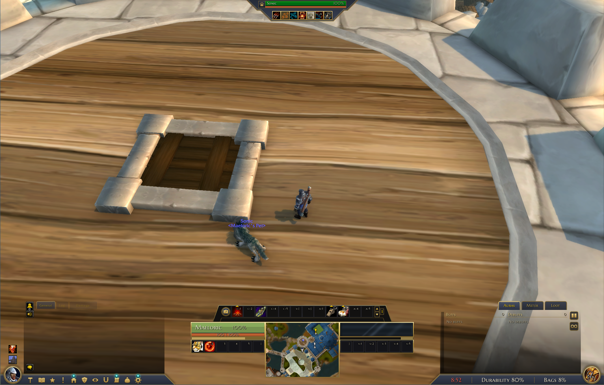
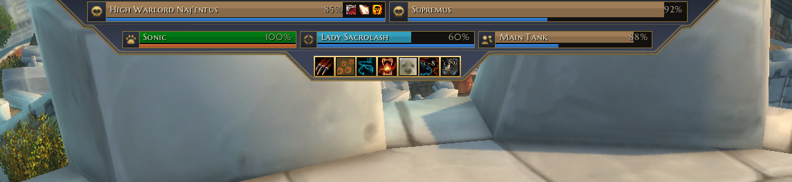
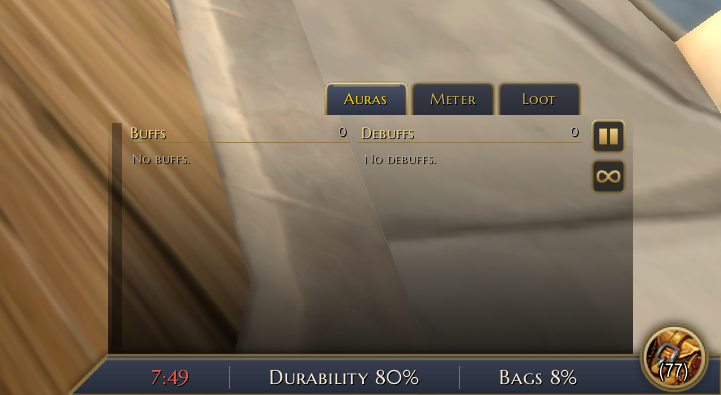
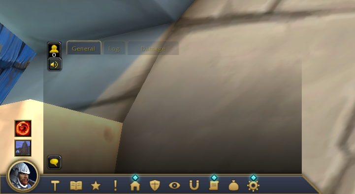
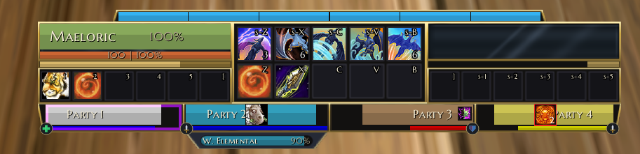

# Medalluin

> **A bespoke, artful HUD, unit frame, and console suite for World of Warcraft.**

Medalluin transforms World of Warcraft's interface into a unified, ornamental console rendered in an elegant ink-and-gold art style. By wrapping Blizzard's secure templates into custom frames, Medalluin preserves full native combat security, macros, drag-and-drop, and keybindings while delivering a modern, cohesive UI experience.

---

> [!NOTE]
> ### 🤖 AI-Assisted Development Disclaimer
> **Medalluin is developed with the assistance of Artificial Intelligence.** Design specifications, art tooling, secure template integration, and code iterations have been co-authored and refined using advanced AI paired with human testing and direction. Code is thoroughly linted and harness-tested for taint safety and combat protection.

---

## 📸 Showcase

### Full Screen Interface

### Overhead Console

### Classic Console

### Chat & Resource Panels
| Chat | Resource Panels |
|:---:|:---:|
|  |  |

### Alternative Console Profile

---

## ✨ Features

### 🎮 Central Console & Unit Frames
- **Player & Target Frames**: Sculpted into the primary bottom console with smoothly animated health/power bars, class colors, combat threat glows, and status badges.
- **Console Profiles**:
  - **Medallion (Default)**: Symmetrical ornamental console with central artwork, power/cast meters, and expandable side panels.
  - **Central Console (Light)**: Streamlined, compact variant featuring an integrated minimap bay, a 2x5 form/stance/skyriding center grid (`Action Bar 7`), and a dedicated 4-member party row directly under the console.
- **Overhead & Boss Frames**: Overhead boss cast bars, health bars, and target-of-target indicators designed to float cleanly above combat encounters.
- **Party & Raid Layouts**: Choose between the integrated **Console Row** or flexible, draggable **Widgets** for Party, Raid, Boss, and Arena units.
- **Distinctive Offline & Dead States**:
  - **Offline**: Distinct plug/unplug icon with diagonal hazard-striped texture bars.
  - **Dead**: Angel halo wings icon, formatted death duration timer, character name, and embossed skull-texture bars.

---

### ⚔️ Action Bars & Keybinds
- **Customizable Rows**: Run 1, 2, or 3 rows (Action Bar 1, MultiBar Bottom Left, and MultiBar Bottom Right).
- **Art Style Options**:
  - **With Art**: Preserves Blizzard's iconic button textures with tinting and custom frame styling.
  - **Bare Icons**: Modern WeakAuras-style clean flat icons with centered cooldown digits, formatted hotkey abbreviations (`s-1`, `c-E`, `M4`), and usable range tints.
- **Hide Empty Buttons**:
  - Automatically hides unused button slots and keybind text on extra bars (rows 2 and 3) while keeping Action Bar 1 and stance grids visible.
  - Seamless drag-and-drop: hovering an item, spell, or macro automatically reveals the empty slots so you can place abilities.
- **Built-in Power & Cast Bars**: Integrated segment-based class power display (Holy Power, Combo Points, Runes, Soul Shards, Arcane Charges, Dragonriding Vigor) and responsive cast bars.
- **Keybinding Overlay (`/mdlui kb`)**: Point and click on any action button and press a key to immediately bind or update hotkeys.

---

### ⚙️ Profiles & Complete Customizability
- **Per-Profile Independence**: Settings are stored per profile, allowing distinct layouts and settings across characters or specs.
- **Action Bar Skills & Keybinds by Profile**: Medalluin remembers which spells, items, macros, and bindings belong to each profile and restores them seamlessly on profile or spec switches.
- **In-Game Unit Frame Editor (`/mdlui edit`)**:
  - Interactive visual editor with a live side-by-side canvas.
  - Customize piece dimensions, fonts, text formats, offsets, and visibility for every unit frame.
  - Fully secret-guarded to prevent combat lockups and taint.

---

### 🎒 All-In-One Bags (Inspired by Baganator)
- **Single Window Experience**: Combines your backpack, equipped bags, and reagent bag into a single unified window.
- **Equipped Bag Drawer**: Open the bag drawer above the window to inspect, swap, or equip containers without cluttering the screen.
- **Automatic Category Grouping**: Organize items into intuitive categories: *New*, *Equipment*, *Consumables*, *Quest items*, *Trade goods*, *Junk*, and *Other*.
- **Blizzard Search & Sorting**: Full native support for text search, item quality dimming, and one-click bag sorting.
- **Responsive Resizing**: Drag the bottom-right corner dots to change columns across, with automatic window height scaling.

---

### 🌟 Miscellaneous Highlights
- **Dynamic LFG Queue Eye**: The queue status eye automatically replaces the character medallion on the left strip whenever you are in queue for a dungeon, raid, or battleground.
- **Dynamic Vehicle Exit Seat**: When operating a vehicle or on an early-landing taxi, a custom crimson-and-gold ejection seat replaces the backpack medallion on the right strip.
- **Minimap Addon Drawer**: Neatly collects minimap icons (DBM, Details, RaiderIO, Bagnon, etc.) into a collapsible drawer next to the action bar to keep your minimap clean.
- **Side Panel Integration**: Integrated side strip supporting embedded damage meters (Details/Recount), timeless logs, and aura trackers.

---

## ⌨️ Slash Commands

| Command | Description |
|:---|:---|
| `/mdlui` or `/mui` or `/medalluin` | Opens the Medalluin settings window |
| `/mdlui bar` | Opens settings directly to the Action Bar tab |
| `/mdlui party` / `raid` / `boss` | Opens settings directly to unit frame pages |
| `/mdlui kb` | Enters quick keybinding mode (hover button and press key) |
| `/mdlui edit` | Launches the interactive unit frame layout editor |
| `/mdlui taint` | Runs internal diagnostics to inspect secure variable integrity |

---

## 🛠️ Work in Progress & Contributions

> [!IMPORTANT]
> **Medalluin is an active work-in-progress (WIP).** 
> Features, textures, and capabilities are continuously evolving.

- **Issues & Suggestions**: Feel free to submit an issue on GitHub for bug reports, compatibility edge cases, or feature suggestions.
- **Pull Requests**: Community contributions, optimizations, and bug fixes are welcome! Please ensure code adheres to standard Lua conventions and passes `luacheck` and the test harness before opening a PR.

---
